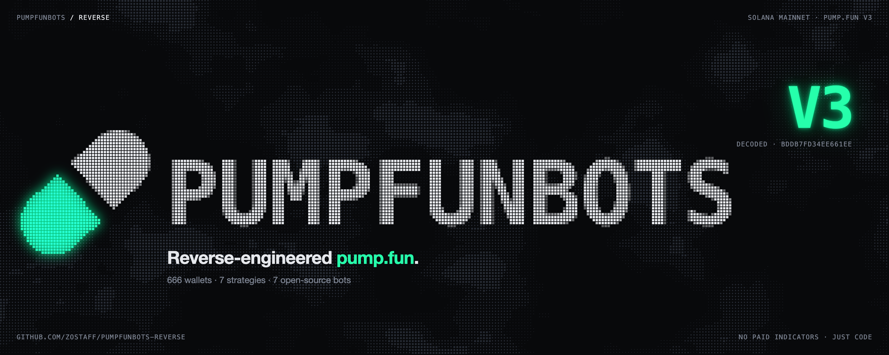
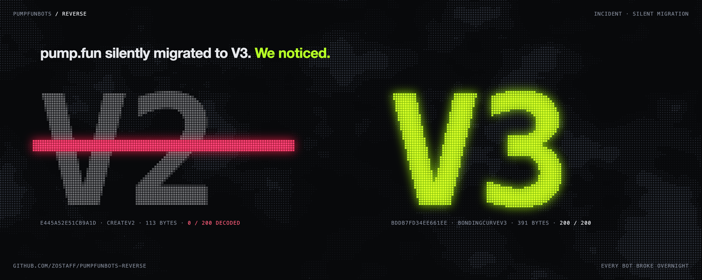
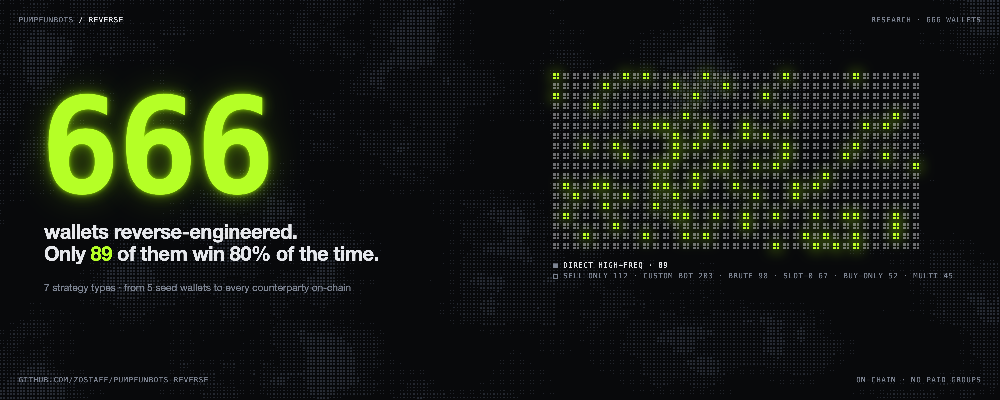
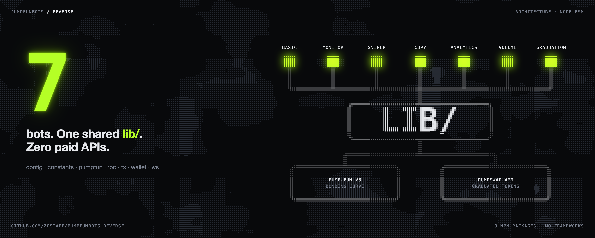
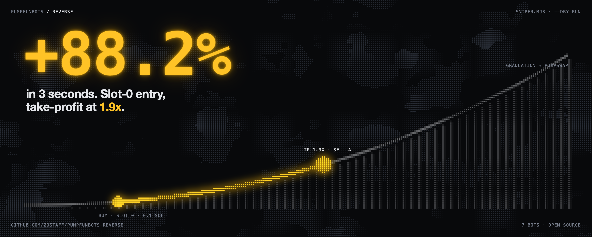
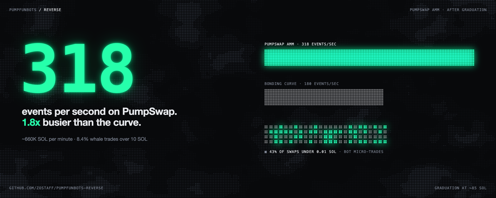
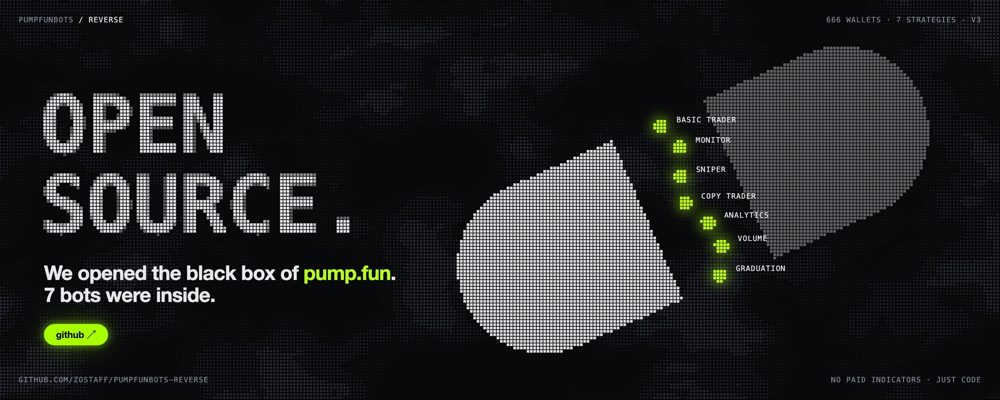

<p align="center">
  
</p>

<p align="center">
  <a href="#quick-start"></a>
  <a href="#v3-migration"></a>
  <a href="#strategy-research"></a>
  <a href="#bots"></a>
  <a href="#stack"></a>
</p>

<p align="center">
  <code>pumpfunbots / reverse</code> &nbsp;·&nbsp; on-chain intelligence toolkit for pump.fun &nbsp;·&nbsp; <code>no paid indicators, just code</code>
</p>

---

## Quick Start

```bash
git clone https://github.com/zostaff/pumpfunbots-reverse.git
cd pumpfunbots-reverse
npm install
cp .env.example .env          # add your Helius API key
```

```bash
# generate a trading wallet
node -e "import('./lib/wallet.mjs').then(m => m.generateKeypair())"

# monitor new tokens in real-time
node bots/monitor/stream.mjs

# sniper bot (paper trading)
node bots/sniper/sniper.mjs --dry-run

# live analytics dashboard
node bots/analytics/server.mjs    # open localhost:3000
```

---

## V3 Migration




> pump.fun silently migrated to V3. Every existing bot using old prefixes is dead. We decoded the new format.

```
                        V2 (DEAD)                    V3 (LIVE)
 ──────────────────────────────────────────────────────────────
  Trade event        e445a52e51cb9a1d            bddb7fd34ee661ee
  Event size         113 bytes                   390-391 bytes
  Buy/sell           is_buy byte                 Instruction name
  Create             CreateV2 event              BondingCurveV3
  User pubkey        offset 57                   offset 57 (verified)
  Reserves           not in event                offset 97-113
  New features       -                           cashback, holder fees
 ──────────────────────────────────────────────────────────────
```

<details>
<summary><b>V3 Event Layout (click to expand)</b></summary>

```
Offset   Size   Field
───────────────────────────────────────
0        8      Discriminator (bddb7fd34ee661ee)
8        32     Mint (Pubkey)
40       8      SOL amount (u64 lamports)
48       8      Token amount (u64)
57       32     User (Pubkey)
97       8      Virtual SOL reserves (u64)
105      8      Virtual token reserves (u64)
113+     278    Extended data
```

Buy/sell determined from instruction names in tx logs:
```
BUY:    Buy, BuyV2, BuyV3, BuyExactQuoteInV2, BuyExactQuoteInV3, BuyExactSolIn
SELL:   Sell, SellV2, SellV3
CREATE: BondingCurveV3, BondingCurveJupiter
```

</details>

---

## Strategy Research




```
 666 wallets analyzed across 7 strategy types
 ──────────────────────────────────────────────────────────────

  Direct High-Freq    ██████████████████████████████████████  80%   89 wallets
  Sell-Only           █████████████████████████               62%  112 wallets
  Slot-0 Sniper       ██████████████████                      45%   67 wallets
  Multi-Program       ████████████████                        40%   45 wallets
  Custom Bot          ██████████████                          35%  203 wallets
  Brute Force         ██████████                              25%   98 wallets
  Buy-Only            ██████                                  15%   52 wallets
```

<details>
<summary><b>Strategy Details</b></summary>

| Strategy | How it works | Key signal |
|----------|-------------|------------|
| **Direct High-Freq** | Standard instructions, CU=0, pure selection edge | No custom programs |
| **Sell-Only** | Never buys on pump.fun, receives via bundles/airdrops | Coordinated ops |
| **Slot-0 Sniper** | Buys same slot as token creation | Latency game |
| **Custom Bot** | Deploys own program, calls pump.fun via CPI | Custom program ID |
| **Multi-Program** | Multiple programs per tx (buy + tip + routing) | Complex tx layout |
| **Brute Force** | High volume, low selectivity, needs 4x+ winners | Spray and pray |
| **Buy-Only** | Never sells on pump.fun (AMM exit or honeypot test) | One-directional |

</details>

---

## Bots




| | Bot | What it does | Run |
|-|-----|-------------|-----|
| `01` | **Basic Trader** | CLI buy/sell/price/balance | `node bots/basic-trader/trade.mjs buy <mint> 0.1` |
| `02` | **Monitor** | Real-time token + trade stream | `node bots/monitor/stream.mjs` |
| `03` | **Sniper** | Auto-buy on creation, TP/SL exit | `node bots/sniper/sniper.mjs --dry-run` |
| `04` | **Copy Trader** | Mirror target wallet trades | `node bots/copy-trader/watcher.mjs --dry-run` |
| `05` | **Analytics** | Live dashboard at :3000 | `node bots/analytics/server.mjs` |
| `06` | **Volume Analyzer** | Wallet/token strategy classifier | `node bots/volume-analyzer/analyzer.mjs wallet <addr>` |
| `07` | **Graduation Sniper** | Buy before PumpSwap migration | `node bots/graduation-sniper/graduation.mjs --dry-run` |

<details>
<summary><b>Shared Library (lib/)</b></summary>

| Module | Purpose |
|--------|---------|
| `config.mjs` | `.env` loader, slippage (5%), CU budget, tip size |
| `constants.mjs` | Program IDs, V3 event prefixes, instruction sets |
| `pumpfun.mjs` | Bonding curve PDA, state deserialization, buy/sell ix |
| `rpc.mjs` | Connection, shared RPC budget, sendTx |
| `tx.mjs` | Versioned tx builder, ComputeBudget, Jito tip |
| `wallet.mjs` | Keypair load/generate from `keys/` |
| `ws.mjs` | WebSocket with auto-reconnect |
| `rugcheck.mjs` | Rug-Check vor jedem Kauf |
| `buy-gate.mjs` | Freigabe oder `--dry-run`, danach erst Signatur |
| `approval.mjs` | Lokale Freigabe-Warteschlange |
| `positions.mjs` | Fill-Preis, Stop-Loss, Positionen auf der Platte |

</details>

## Sicherheitslayer

Sniper, Copy-Trader und Graduation-Sniper kaufen nicht mehr blind.

- **Rug-Check** (`lib/rugcheck.mjs`) vor jedem Kauf. Abgelehnt wird bei gesetzter Mint- oder Freeze-Authority, zu hohem Anteil des größten Holders, zu hohem Dev-Buy des Creators, zu vielen selbst gesehenen Launches, einem früheren Stop-Rug desselben Creators und bei zu dünner realer Liquidität. Eine volle Signaturseite (oft genau 100) ist keine Historie. Schwellen stehen in `.env.example`. Jede Ablehnung landet mit Grund im Log. Ein HTTP 429 wird als `RUG DEFER` später erneut versucht und nie als Kauf und nie als Rug gezählt.
- **Freigabe.** Standardmäßig signiert der Bot einen Kauf nicht selbst. Er schreibt Token, Betrag, Grund und Rug-Check-Ergebnis nach `data/approvals.json` und wartet. Freigeben: `node bots/approve.mjs approve <id>` oder der Button im lokalen Dashboard. Unbestätigte Vorschläge verfallen (`APPROVAL_TTL_SEC`). `AUTO_BUY=1` oder `--auto` ist der Opt-out und ist standardmäßig aus. `--dry-run` signiert nie, auch nicht zusammen mit `--auto`.
- **Stop-Loss −6 %.** `SNIPER_STOP_LOSS`, `COPY_STOP_LOSS` und `GRAD_STOP_LOSS` stehen standardmäßig auf `0.94` vom Fill. Jede offene Position hat ein eigenes Log-Abo, und der Backup-Poll fragt pro Tick nur eine gehaltene Position ab (`POSITION_POLL_MS`, Standard 1 s), weiter im gemeinsamen RPC-Budget. `STOP_EARLY_MARGIN` (Standard 0,03) löst den Verkauf bei 0,97 aus, damit der Fill näher an −6 % landet statt bei 0,71. Der Sniper schreibt nach jedem Verkauf eine Session-Zeile mit SOL-PnL.
- **Sniper nur bei neuen Launches.** Ein späteres Event mit schon 12 SOL oder mehr in der Curve ist kein Create (`SNIPER_MAX_CURVE_SOL`). Derselbe Mint wird nicht erneut gekauft (`SNIPER_NO_REENTRY_AFTER_STOP`, `SNIPER_TOKEN_COOLDOWN_SEC`). Sniper und Graduation-Sniper halten über `data/open-mints.json` nicht gleichzeitig denselben Mint.
- **Graduation.** Der erste Print über der Fill-Schwelle kauft nicht. `GRAD_CONFIRM_SEC` (Standard 8 s) und `GRAD_CONFIRM_MAX_DIP` (Standard 2 %) lassen einen Dip aus. Nach einem Stop gibt es keinen Wiedereinstieg (`GRAD_NO_REENTRY_AFTER_STOP`), und jedes Token hat eine eigene Pause (`GRAD_TOKEN_COOLDOWN_SEC`).

Die Offline-Simulation unter `simulation/` fährt dieselben Regeln mit Spielgeld. Siehe `simulation/README.md`.


---

## Sniper Results (dry-run)




```
[12:18:22] SNIPING: DYdfB51GxXj1SydBJm8uJbndgPBTs8dYwZEg6yF6pump
  buying 0.1 SOL -> ~7,235,110 tokens
  entry: 0.000013566412 SOL/tok
  [DRY RUN] position tracked

[12:18:25] SELL (take-profit 1.9x)
  +88.2%, held 3 seconds
  session: 1 trade, 1W/0L

  45 seconds total: 3 trades, 2W/1L, 66% win rate
```

---

## PumpSwap AMM




> When a bonding curve fills (~85 SOL), the token graduates to PumpSwap AMM.

```
 PumpSwap is 1.8x busier than bonding curve
 ──────────────────────────────────────────

  Events/sec      318 (vs 180 bonding curve)
  Volume          ~660,000 SOL/min
  Bot trades      43% under 0.01 SOL
  Whale trades    8.4% over 10 SOL

  Trade prefix    67f4521f2cf57777  (497 bytes)
  Fee prefix      3e2f370aa503dc2a  (449 bytes)
  Program         pAMMBay6oceH9fJKBRHGP5D4bD4sWpmSwMn52FMfXEA
```

---

## Landing Providers

> Speed infrastructure identified from tip transfer patterns.

| Provider | Addresses | Notes |
|----------|-----------|-------|
| **Jito** | 8 accounts | Dominant. MEV bundles. |
| **Astralane** | 11 (astr* prefix) | Growing fast |
| **Nozomi** | 18 (noz* prefix) | Speed-focused |
| **MoonLander** | 8 (moon* prefix) | Mid-tier |
| **GMGN.ai** | 9 (gmgn* prefix) | Consumer bots |

Our bots use Jito tips with random account selection.

---

## Stack

```
Runtime         Node.js 22+ (ESM)
Chain           Solana mainnet via Helius RPC
Programs        pump.fun    6EF8rrecthR5Dkzon8Nwu78hRvfCKubJ14M5uBEwF6P
                PumpSwap    pAMMBay6oceH9fJKBRHGP5D4bD4sWpmSwMn52FMfXEA
Dependencies    @solana/web3.js  @solana/spl-token  bs58  ws
                (4 packages. no frameworks. no build tools.)
```

---

## Research

| File | Content |
|------|---------|
| [`docs/strategy-research.md`](docs/strategy-research.md) | 7 strategy classifications, win rates, PnL |
| [`docs/wallet-analysis.md`](docs/wallet-analysis.md) | Deep on-chain wallet behavior analysis |
| [`docs/article.md`](docs/article.md) | Full writeup of the reverse engineering process |
| [`docs/GUIDE.md`](docs/GUIDE.md) | Complete guide from beginner to advanced |
| [`docs/covers/`](docs/covers/) | Cover generator: `cover.html?v=1..7`, rendered by `render.sh` |

---

<p align="center">
  <a href="https://github.com/zostaff/pumpfunbots-reverse"></a>
</p>

<p align="center">
  <sub>A research tool, not a promise of returns. Start with <code>--dry-run</code>.</sub>
</p>

<p align="center">
  <sub>Built from raw on-chain data. No paid signals. No black boxes. Just code.</sub>
</p>
